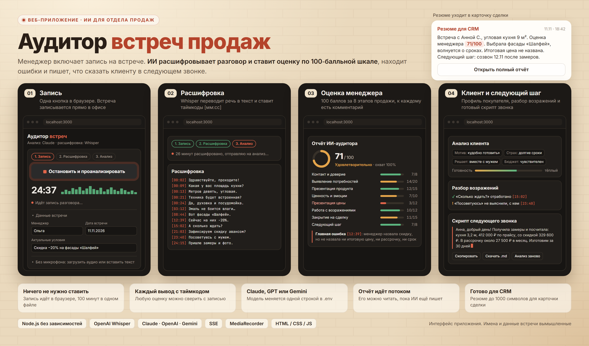

# Sales Meeting Auditor

**Аудитор встреч отдела продаж.** Нажмите «Начать запись», проведите встречу с клиентом. После остановки ИИ расшифрует разговор и выдаст отчёт: оценку менеджера по 100-балльной шкале, профиль клиента, разбор возражений, готовый скрипт следующего звонка и резюме для CRM.

*Record a sales meeting in the browser → transcribe it with Whisper → get an AI audit: manager score, client profile, objections, next-call script and a CRM summary. Zero dependencies, Node.js, Claude / OpenAI / Gemini.*



## Возможности

- **Запись в браузере** через MediaRecorder: ничего не нужно устанавливать. Без микрофона можно загрузить аудиофайл или вставить готовый текст.
- **Расшифровка с таймкодами** `[мм:сс]` (OpenAI Whisper или бесплатно через Groq). Каждый вывод в отчёте ссылается на момент записи.
- **Три LLM-провайдера:** Claude, OpenAI или Gemini. Переключение одной строкой в `.env`.
- **Отчёт идёт потоком** (SSE), его можно читать, пока модель пишет.
- **Методика задаётся промптом.** Этапы, баллы и формат отчёта лежат в [prompts/auditor.md](prompts/auditor.md). Правки применяются без перезапуска сервера.
- **Ноль зависимостей:** только Node.js, без `npm install`.

## Запуск

Нужен Node.js 20.6+.

```bash
cp .env.example .env        # впишите ключи (Windows: copy .env.example .env)
node --env-file=.env server.js
# открыть http://localhost:3000
```

| Переменная | Зачем |
|---|---|
| `OPENAI_API_KEY` | обязательна — расшифровка Whisper (и анализ, если `LLM_PROVIDER=openai`) |
| `LLM_PROVIDER` | `anthropic` (по умолчанию), `openai` или `gemini` — какая модель делает анализ |
| `ANTHROPIC_API_KEY`, `ANTHROPIC_MODEL` | для `LLM_PROVIDER=anthropic` |
| `GEMINI_API_KEY`, `GEMINI_MODEL` | для `LLM_PROVIDER=gemini` (бесплатный ключ в Google AI Studio) |
| `OPENAI_BASE_URL`, `WHISPER_MODEL` | расшифровка через Groq: `https://api.groq.com/openai` и `whisper-large-v3-turbo` |
| `OPENAI_MODEL` | модель анализа для `LLM_PROVIDER=openai` |

Микрофон работает на `http://localhost` или по HTTPS.

## Настройка под свою компанию

Откройте [prompts/auditor.md](prompts/auditor.md) и заполните:

1. **«О компании»**: продукт, аудитория, преимущества, конкуренты, стандарт презентации цены.
2. **«Этапы встречи и баллы»**: этапы вашей воронки и их вес (сумма — 100).
3. **«Формат отчёта»**: при необходимости добавьте или уберите разделы.

Блок `# ВХОДНЫЕ ДАННЫЕ` с плейсхолдерами `{{...}}` заполняет приложение, его оставьте. Данные встречи (менеджер, дата, CRM, актуальные акции) вводятся на странице. Пустые поля подставляются как «Не указано».

## Как устроено

```
браузер (MediaRecorder) ──аудио──▶ POST /api/transcribe ──▶ Whisper ──▶ текст с таймкодами [мм:сс]
        ▲                                                                      │
        └──── отчёт стримится (SSE) ◀── POST /api/analyze ◀── промпт + текст ◀─┘
                                              └─▶ Claude / OpenAI / Gemini
```

- `server.js` — HTTP-сервер и маршруты. Каждая сессия сохраняется в `data/<id>/` (аудио, расшифровка, отчёт).
- `lib/transcribe.js` — Whisper и форматирование сегментов с таймкодами.
- `lib/llm.js` — адаптеры Claude, OpenAI и Gemini с потоковой выдачей. Новый провайдер добавляется одной функцией.
- `lib/prompt.js` — делит промпт на системную часть и входные данные, подставляет поля встречи.
- `public/` — интерфейс (один экран).

## Ограничения

- Whisper не размечает говорящих. Модель определяет роли менеджера и клиента по смыслу, это работает, но с разметкой было бы точнее. Можно улучшить моделью с диаризацией или записью на два канала.
- Whisper принимает файлы до 25 МБ. Запись идёт с 32 кбит/с, это примерно 100 минут. Для более длинных встреч нужна нарезка.
- Нет авторизации и базы данных: приложение рассчитано на локальный запуск. Ключи хранятся только на сервере.
- Интонацию и мимику по записи не оценить, промпт это учитывает.

## Интеграция с CRM

Раздел «Краткое резюме для CRM» ограничен 1000 символами и подходит для прямого переноса в карточку сделки. Следующий шаг — автоматизация: запись из телефонии → расшифровка → анализ → примечание в сделке через API CRM (например, amoCRM). Поля `CRM_DATA` и `CLIENT_HISTORY` в промпте уже предусмотрены.
